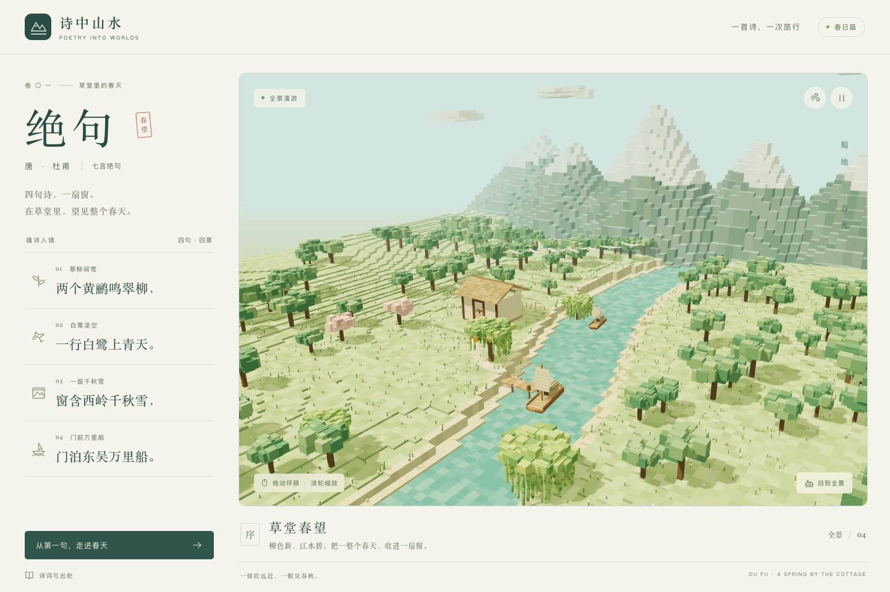

# 绝句 · 草堂春望

走进杜甫《绝句》的春日山水。四句诗、四个镜头，共享一片连续的体素世界：垂柳与黄鹂、青天与白鹭、草堂的窗与西岭的雪、门前的河与远行的船。



## 本地运行

需要 Node.js 22.13+ 和 pnpm（版本由 `package.json` 的 `packageManager` 指定）。

```sh
pnpm install
pnpm dev --port 5175
```

开发页面：<http://localhost:5175/spring-cottage/>。

```sh
pnpm check                         # TypeScript 类型检查
pnpm lint                          # Biome 格式、导入顺序与 lint 检查
pnpm format                        # 统一代码格式
pnpm build                         # 类型检查与生产构建，输出 dist/
pnpm preview --port 4175 --strictPort
```

生产预览：<http://localhost:4175/spring-cottage/>。Vite 的资源基础路径为 `/spring-cottage/`，与 GitHub Pages 仓库站点路径一致。所有景物均程序化生成，无需外部贴图、音频或字体请求。

## GitHub Pages 部署

目标地址：<https://echo-dm.github.io/spring-cottage/>。

1. 在 GitHub 仓库 **Settings → Pages → Build and deployment → Source** 中选择 **GitHub Actions**。
2. 将配置提交并推送至 `main`；`.github/workflows/deploy.yml` 会自动安装依赖、检查代码、构建并发布 `dist/`。
3. 也可在 **Actions → Deploy to GitHub Pages → Run workflow** 手动触发，选择 `main` 分支。
4. 等待构建和部署任务成功后，打开目标地址确认场景与交互正常。

工作流使用 Node.js 22 和项目指定的 pnpm 版本，通过 `pnpm install --frozen-lockfile` 安装依赖；只有 lint 与生产构建成功才会部署。部署使用内置 `GITHUB_TOKEN`，无需另配发布密钥。构建通过只代表产物生成成功，实际上线以 Actions 部署结果及公开页面验证为准。

## 操作

- 点击完整诗句或「从第一句，走进春天」，约 2.1 秒抵达对应景物；连续点击以最后选择为准。
- 拖动环顾、滚轮缩放；触屏支持单指环顾和双指缩放。开始拖动即中断当前漫游。
- 「回到全景」重新交代草堂、河谷和远山的位置。手机选句后自动滚回景观。
- 右上角可暂停风物动画、减少动态。暂停保留相机操作；减少动态会停下风物并直接切换镜头，默认遵循系统设置。
- 诗句按钮支持 Tab、Enter 和空格。点击「诗词与出处」查看版本及意象说明，Escape 关闭。
- 图形不可用或连接中断时仍可读全文；连接恢复会继续绘制，也可点击「重新载入山水」。

## 诗词与意象

> 两个黄鹂鸣翠柳，一行白鹭上青天。\
> 窗含西岭千秋雪，门泊东吴万里船。

全文核对自[香港教育局「建议篇章」《绝句》](https://www.edb.gov.hk/attachment/tc/curriculum-development/kla/chi-edu/recommended-passages/ks2_11_text.pdf)，由繁体转为简体，保留句序和标点。四句分别设置独立入口；「鸣」通过鸟的姿态表现，采用纯视觉体验。

草堂形制、花草、码头和河道是视觉补充；景物间的距离为构图与漫游压缩，并非历史地理复原。「千秋」「万里」借远山与泊船的远近关系表达。

## 源码组织

使用严格 TypeScript、两空格缩进、单引号和分号；Biome 配置集中在 `biome.json`，仅检查源码、验收脚本和构建配置。

- `src/poem.ts`：全文、稳定句子 ID、出处、描述和镜头参数。
- `src/App.tsx`：React 导航、状态、动效偏好、出处弹窗与恢复入口。
- `src/world.ts`：Three.js 生命周期、相机、OrbitControls、渲染与图形恢复。
- `src/landscape.ts`：固定随机种子的地形、雪岭、垂柳、草堂、鸟与船；重复方块实例化。
- `src/style.css`：桌面、平板和手机布局。
- `scripts/qa.mjs`：通过 agent-browser 在真实 Chromium 中执行验收，CDP 补充滚轮坐标和触控手势。
- `docs/`：实际验收记录、机器结果与截图。

## 浏览器验收

先确保 `agent-browser` CLI 和 Chromium 已安装，在另一个终端启动生产预览，然后运行：

```sh
pnpm qa http://127.0.0.1:4175/spring-cottage/
# 同时检查开发环境 StrictMode，需另行启动开发服务：
pnpm qa http://127.0.0.1:4175/spring-cottage/ http://127.0.0.1:5175/spring-cottage/
```

结果写入 `docs/qa-results.json`，截图写入 `docs/screenshots/`。完整覆盖范围与限制见 [验收记录](docs/acceptance.md)。模拟手机使用桌面 Chromium 的设备模拟，真实手机尚未验证。
